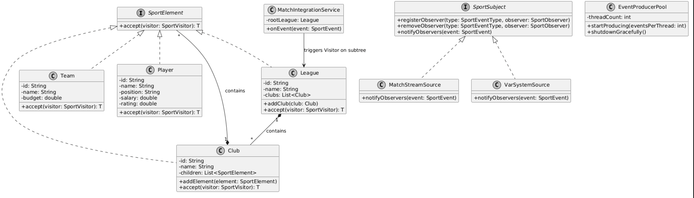

# Live Sports

---

## Architecture & UML Diagram

The system integrates four primary software engineering concepts: Composite tree layout, decoupled Visitor operations, thread-safe Observer event propagation, and a multi-threaded execution pool.

* **UML Diagram :** 

## Project Structure & Class Responsibilities

```text
sdp_live_sports/
├── src/
│   ├── sports/
│   │   ├── app/           # Main application entry point & composition root
│   │   ├── concurrent/    # Multi-threaded event generators (ExecutorService)
│   │   ├── integration/   # Bridge connecting Observer streams to Visitor logic
│   │   ├── observer/      # Event sources, listeners, registry, and event definitions
│   │   └── visitor/       # Composite nodes, leaves, and operation visitors
│   └── test/              # Comprehensive JUnit 5 test suite
├── Uml/
│   └── Diagram.png        # Architecture diagram image
├── pom.xml                # Maven configuration file
└── README.md              # Project documentation
```

## Classes & Components Breakdown

### `sports.visitor` (Composite & Visitor Patterns)
* **`SportElement`** *(Interface)* — Base composite component declaring the `accept(SportVisitor)` dispatch method.
* **`SportVisitor<T>`** *(Interface)* — Visitor interface contract declaring visit methods for all structural nodes.
* **`League`** *(Composite)* — Top-level root node containing a collection of `Club` instances.
* **`Club`** *(Composite)* — Container node grouping teams, players, coaches, and staff members.
* **`Team`** *(Composite)* — Structural unit maintaining team-level metadata and child nodes.
* **`Player`** *(Leaf)* — Leaf element storing player attributes (salary, rating, position).
* **`Coach`** *(Leaf)* — Leaf element representing coaching personnel and salary details.
* **`StaffMember`** *(Leaf)* — Leaf element representing support staff members.
* **`SalaryCalculationVisitor`** *(Visitor)* — Traverses the hierarchy to calculate the total salary expense across a subtree.
* **`RatingAccumulatorVisitor`** *(Visitor)* — Aggregates player ratings and computes average ratings across teams/clubs.
* **`ElementFilterVisitor`** *(Visitor)* — Filters nodes based on matching conditions (e.g., specific positions or node types).
* **`JsonExportVisitor`** *(Visitor)* — Serializes the entire sports organization tree into a formatted JSON representation.

### `sports.observer` (Observer Pattern)
* **`SportSubject`** *(Interface)* — Subject contract for registering, unregistering, and notifying observers.
* **`SportObserver`** *(Interface)* — Listener interface receiving incoming `SportEvent` instances.
* **`MatchStreamSource`** *(Subject)* — Thread-safe event subject broadcasting live match occurrences.
* **`VarSystemSource`** *(Subject)* — Secondary event subject handling VAR review notifications.
* **`MatchAggregatorListener`** *(Observer)* — Relays and summarizes raw events into composite match summaries.
* **`EventRegistry`** *(Registry)* — Thread-safe registry built with `ConcurrentHashMap` managing listener subscriptions.
* **`SportEvent`** *(Value Object)* — Immutable value object representing domain event state.

### `sports.integration` (Integration Layer)
* **`MatchIntegrationService`** *(Service)* — Acts as a bridge between Observer and Visitor patterns. Upon receiving specific match summary events, it automatically triggers Visitor traversals on target subtrees.

### `sports.concurrent` (Concurrency)
* **`EventProducerPool`** *(Manager)* — Manages a fixed thread pool (`ExecutorService`) to simulate real-time high-throughput concurrent event streaming.

### `sports.app` (Application Root)
* **`Main`** *(Entry Point)* — Initializes the structural tree, wires Observer dependencies, starts multi-threaded event pools, and executes system operations.